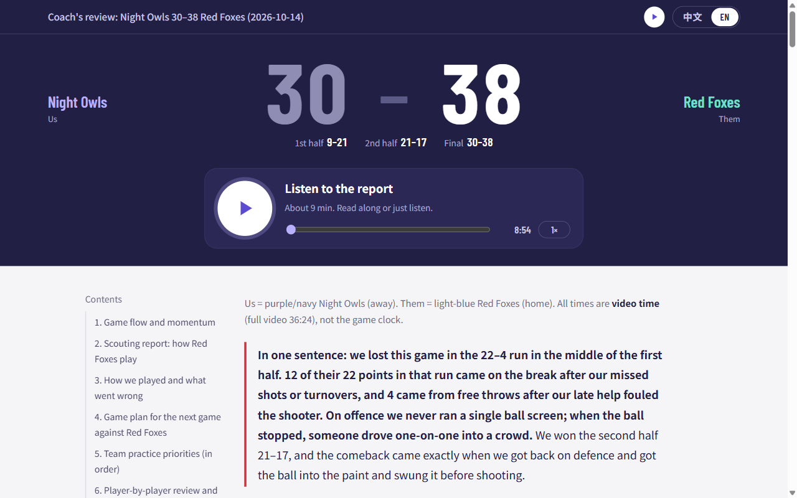
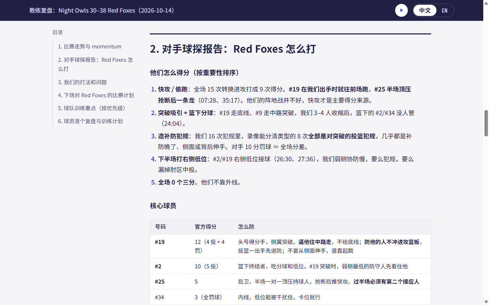
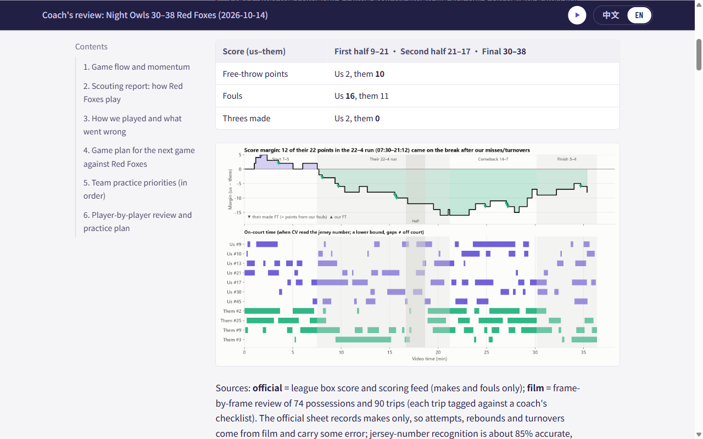
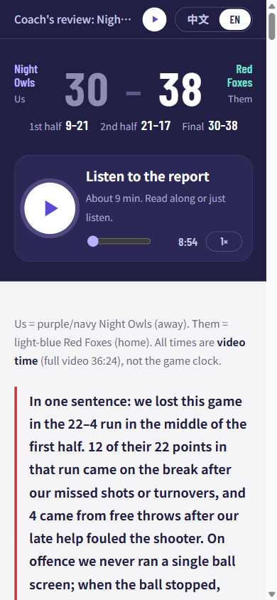

# gem-in-game

**Turn the video of your amateur basketball game into a coach's report: what happened, why you lost or won, what each player should practise, and a narrated version your teammates can listen to.**

You bring one game video. Your AI coding agent ([Claude Code](https://claude.com/claude-code) or [Codex](https://openai.com/codex)) runs the pipeline in this repo on your own GPU, reviews the film like a coach, and writes the report.

English · [中文](README.zh.md)



## What you get

For every game, one folder with:

- **A coach report** in English and Chinese, switchable on the page: how the game went, the opponent's key players and habits, what worked and what didn't for you, a game plan for the rematch, and a practice plan.
- **A review of every player on your team**, with what went well, what to fix, and two drills each. You can send it to the whole team.
- **Charts** of the score margin and scoring runs, shot zones, heat maps, and team comparisons.
- **A narrated MP3** of the report in both languages, with a big play button on the page. Teammates without time to read can listen on the way to practice.
- **One shareable HTML file**: images and audio embedded, opens offline, works in chat apps.
- **Optional extras:** a private deep dive for one player, and a short looping MP3 of on-court cues ("two dribbles, find a man") to listen to while you play.

Every claim in the report points to a video time, so a player can go and watch the moment.

| Bilingual report | Charts | On a phone |
|---|---|---|
|  |  |  |

*Screenshots are from a real game with the team names changed.*

## How it works

```
game video ──► computer vision (GPU, ~1 h) ──► film review by AI agents ──► report + charts + narration ──► one HTML file
               players, ball, court position      coach checklist per         written from structured facts
               teams, jersey numbers              stretch of the game         with video times for every claim
```

1. **Computer vision:** detects players and the ball every frame, maps them onto the court, splits the two teams by jersey colour, and reads jersey numbers.
2. **Possessions and lineups:** who was on court, who had the ball, when each possession started and ended. If your league publishes a box score, it is aligned with the video.
3. **Film review:** the game is cut into annotated frame sheets. Your agent sends subagents through them with a coach's checklist covering transition defence, ball pressure, shot selection and more.
4. **Facts first, then writing:** reviews are merged into fact sheets (plus-minus, stints, patterns, clips). The report is written from those facts using the templates in [`prompts/`](prompts/).
5. **Render:** charts, narration (Microsoft Edge neural voices) and a single self-contained HTML page.

Full details: [docs/pipeline.md](docs/pipeline.md).

## Quick start

### 1. Requirements

- An **NVIDIA GPU** with 8 GB or more of VRAM, on Windows or Linux. The jersey reader needs CUDA.
- [uv](https://docs.astral.sh/uv/), Python 3.11, and `ffmpeg` on your PATH.
- About 20 GB of disk for the models. They download on first use.
- Claude Code or Codex. The pipeline can also be run by hand, but the film review and the writing are agent work.
- One full game video from a single camera on the side of the court (a typical club recording).

### 2. Install

```bash
git clone https://github.com/mariusDing/gem-in-game.git
cd gem-in-game
uv sync
uv run gem-in-game          # lists every stage
```

### 3. Start a game

```bash
uv run gem-in-game new-game --opponent "Red Foxes" --date 2026-10-14 --video path/to/game.mp4 --us-team "Night Owls"
```

This creates `workspace/teams/red-foxes/2026-10-14/` with a `game.json` to fill in: team names, jersey colours, rosters and the final score. Everything in `workspace/` stays on your machine and is never committed.

### 4. Let your agent run it

Open Claude Code or Codex in the repo and say:

> Analyse the game in `workspace/teams/red-foxes/2026-10-14` following docs/playbook.md. We are Night Owls in dark blue.

The agent follows [docs/playbook.md](docs/playbook.md) step by step ([`CLAUDE.md`](CLAUDE.md) and [`AGENTS.md`](AGENTS.md) point it there). It will stop and ask you twice:

1. **Court calibration:** confirm a few court points on a frame.
2. **Team colours:** confirm which colour cluster is your team.

When it finishes, open `workspace/teams/red-foxes/2026-10-14/index.html`.

### 5. Share it

```bash
uv run gem-in-game html workspace/teams/red-foxes/2026-10-14 --share --out Night-Owls_vs_Red-Foxes.html
```

The result is a single file with images and audio inside. Send it in any chat app. If an in-app viewer blocks scripts, the page falls back to the phone's own audio player.

## Commands

| Stage | What it does |
|---|---|
| `new-game` | create the game folder and `game.json` |
| `calibrate` | court calibration keyframes |
| `extract` → `embed` → `tracks` → `jersey` | computer vision: detections, team split, tracking, jersey numbers |
| `analyze` | identities, possessions, tactical metrics |
| `official` | import a league box score and align it to the video (optional) |
| `coach-sheets` → `merge-reviews` → `coach-summary` | film-review sheets, merge and aggregate the agents' reviews |
| `plusminus`, `report`, `momentum`, `replay` | facts and figures |
| `narrate` | spoken script → MP3 (`--chime --gap 6 --loud` makes an on-court cue loop) |
| `html` | report folder → one bilingual HTML page (`--share` for a single sendable file) |

Run `uv run gem-in-game <stage> -h` for the options of each stage.

## Project layout

```
docs/playbook.md     the procedure your agent follows, video → report
prompts/             writing guides: film review brief, coach report, player deep dive, narration, court cues
templates/           game.json and opponent dossier skeletons
src/gem_in_game/     the pipeline (one module per stage)
workspace/           YOUR data: videos, runs, reports (gitignored)
```

## FAQ

**Does it need the internet?** The models download once. After that the vision and analysis run locally. Narration sends the narration text (not the video) to Microsoft's text-to-speech service. Your agent runs on whichever service you use it with.

**Can I run it without a GPU, or on a Mac?** Not yet. Detection falls back to CPU, but that is very slow, and the jersey reader needs CUDA.

**My league has no box score.** That's fine. Put the final score in `game.json` and the report is built from the film review alone.

**How accurate is it?** The vision gives positions and possessions. The judgement comes from the film review, which flags anything uncertain (an unreadable jersey, for example) as "likely". Check the clips it points to before you act on them.

**Which languages?** The report and narration come in English and Chinese.

**Privacy.** The reports name players and show frames of real people. Read [docs/privacy.md](docs/privacy.md) before sharing, especially if minors play in your league.

## Acknowledgements

Built on [RF-DETR](https://github.com/roboflow/rf-detr), [supervision](https://github.com/roboflow/supervision) / [trackers](https://github.com/roboflow/trackers), [SigLIP](https://huggingface.co/google/siglip-base-patch16-224), [Qwen3-VL](https://huggingface.co/Qwen), [edge-tts](https://github.com/rany2/edge-tts), and ideas from [basketball_analysis](https://github.com/abdullahtarek/basketball_analysis). See [docs/research.md](docs/research.md).

## License

[MIT](LICENSE). Models downloaded at run time keep their own licences.

If this helps your team, a ⭐ helps others find it.
